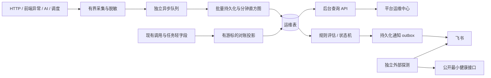

## Context

用户希望参考 sub2api 为短剧制作系统建设完善的运维监控。现有能力是异常采集加小时飞书摘要，缺少运维页面、趋势数据和告警生命周期。具体对照和研究边界见 [reference-research.md](reference-research.md)。本设计假定运维面向平台管理人员，通知沿用现有飞书机器人，运行环境延续当前 Spring Boot 3 / Java 17、MySQL、React 19 / Umi / Ant Design。

现有公共定时调度池曾发生被占用问题，生产历史记录已通过环境将其扩为 4 线程。本功能同时观察调度配置、实际心跳和执行时长，不基于默认配置推断线上故障。

## Goals / Non-Goals

**Goals:**

- 管理员能判断系统健康、接口慢点、AI 失败原因、队列积压、调度停滞与结算滞留，并查看影响团队/项目、发生时间和恢复过程。
- 形成“采集 → 历史查询 → 规则评估 → 告警 → 通知 → 确认/静默/恢复”的完整闭环。
- 监控采集不等待业务数据库写入、不抛异常影响业务；查询有时间范围、分页、超时和基数上限。
- 提供重启后可查的已落库事件、告警状态、通知记录及数据新鲜度；显式展示采集空窗与丢弃数量。
- 支持多实例部署，避免重复聚合、重复事件和重复调度通知；主机或应用完全失联由独立外部探测覆盖。

**Non-Goals:**

- 本期不自动重试付费 AI、修复业务数据、调节并发、改写积分账目或向页面暴露服务器命令。
- 不存请求/响应正文、剧本、提示词、图片 Base64、Cookie、凭据或真实 Webhook；不实现任意 SQL 查询器。
- 不依赖 Elasticsearch、Prometheus/Grafana 或新的消息集群；后续可独立增加标准指标导出。
- 不宣称采集启动前的性能历史可恢复，也不把无流量、未启用、数据缺失显示成健康。

## Decisions

### 1. 方案比较与推荐

| 方案 | 优点 | 成本与局限 | 结论 |
| --- | --- | --- | --- |
| A：应用内运维中心，复用 MySQL、Micrometer、飞书 | 与任务/团队/模型直接关联，用户在现有后台排查；无需新增大型基础设施 | 需约束数据库和采集开销，整机失联需外部探测 | 本期采用 |
| B：Prometheus + Grafana + Alertmanager + 日志平台 | 资源监控与跨应用运维成熟，独立于业务进程 | 额外部署、存储和权限整合；资产/任务/积分仍需业务开发 | 后续规模化扩展 |
| C：仅扩展现有小时消息和异常列表 | 改动少、上线快 | 无完整性能趋势、调度诊断和告警状态，难以满足“完善”目标 | 不作为本期目标 |

### 2. 页面与交互

新增 `/operations` 平台入口，包含七个页签，默认展示最近 1 小时。可选 5 分钟、30 分钟、1 小时、6 小时、24 小时、7 天和最长 90 天自定义区间；时间统一按 Asia/Shanghai 展示，接口以 UTC Instant 收发并显示实际时区。

| 页签 | 内容 | 下钻 |
| --- | --- | --- |
| 总览 | 健康状态、流量、技术错误率、延迟 P50/P95/P99、活动告警、资源和数据新鲜度 | 到对应性能、任务或事件列表 |
| 接口性能 | 标准化路由排行、延迟趋势/分布、慢请求样例、SQL次数与累计耗时 | 请求详情及可关联的任务；无 SQL 采集时显示未采集 |
| AI 运行 | 服务商/模型/场景的调用成功率、限流/超时/业务解析失败、tokens、运行中/等待数与最老等待时间、结算滞留 | execution/attempt/调用日志与只读时间线 |
| 后台任务 | 实例存活、调度计划、最近开始/结束/成功、执行时长、连续失败、心跳延迟、租约异常 | 任务类型、实例与最近错误 |
| 错误日志 | 前端、接口、AI、调度、监控自身事件，按指纹聚合次数和受影响对象 | 脱敏详情、请求关联、发生与最后出现时间 |
| 告警中心 | 当前/历史事件、确认/静默/恢复、通知投递；规则编辑 | 触发证据、指标窗口、阈值、操作历史 |
| 监控设置 | 采集/刷新/保留期、规则默认值、通道就绪状态、监控自身队列/丢弃/落后 | 只显示凭据是否配置，不回传密钥 |

全局筛选支持团队、项目、服务商、模型、业务场景、实例；每块明确适用维度，不能用模型筛选伪装成主机资源按模型变化。已存在的业务详情继续执行其原有权限，新增运维只读详情由运维权限控制，不能借跳转提升权限。

每个活动页签默认 15 秒刷新一次，请求结束后再计时；隐藏暂停、恢复补刷、切筛选取消旧请求并校验 scope。瞬时错误保留上次数据和更新时间；部分数据失败不清空其他卡片；历史固定区间不自动刷新。日志和详情仅在打开后查询，不随总览全量加载。首期不引入 WebSocket。

### 3. 模块边界与数据流

新增 `operations/` 包按 `capture`、`query`、`aggregation`、`jobs`、`alerts`、`notification` 划分；前端按页签组件、服务和单一刷新 Hook 划分。复用现有 `MonitoringText` 脱敏能力并补强，原 `MonitoringBuffer` 的写入经统一 sink 分流，避免替换时遗漏前端或接口事件。原小时汇总保留在每小时 30 分，按已持久化事件查询；事件读取/摘要游标独立于即时告警，重复阅读不删除事件。

首次切换由单一汇总所有者通过数据库租约发送小时消息；旧的多实例 `MONITORING_INCLUDE_AI_TASKS` 仅在旧模式生效。迁移后的摘要查询新事件，AI任务失败不再同时从旧扫描器重复加入同一窗口。通知开启与遥测开启分离，缺少机器人配置不阻止只读监控运行。

### 4. 采集、隔离与存储预算

- HTTP 请求线程仅更新有界计数并向容量 5000 的队列非阻塞 offer；满后丢弃详情并增加计数。异步批次最多 100 条、每秒最多一批；失败指数退避至 30 秒，内存保留最多 60 秒。服务突然停止时尚未落库数据可能丢失，页面通过实例最后心跳标出覆盖空窗。
- 使用独立工作池：采样/刷新计数 1 线程、持久化/轻量对账 1 线程、告警/通知工作池独立且最多 2 线程。监控数据库连接池最大 2，连接获取和 SQL 超时各最多 1 秒，不占用业务 Hikari 连接；运维库仍与业务同 MySQL，限制批量和查询频率。
- HTTP 指标先在内存按实例/分钟/标准路由/方法/结果类别计数，最多 2000 个组合/分钟，超过后汇入 `OTHER` 并显示降维数；用户/项目/trace ID 不作为 HTTP 时序标签。慢请求和错误详情使用有界样例，成功请求不逐条落库。
- 请求使用服务端 requestId，现有 AI traceId 与 requestId 显式关联，不覆盖任务原 traceId。路由在请求结束后读取 Spring 匹配模板；404 统一归类 `UNMATCHED`，绝不把原始数字 ID 或查询参数当作指标标签。
- `/api/platform/operations/**`、监控事件上报、健康探测和静态资源从业务延迟指标中排除；媒体播放/上传/同步 AI 等长连接独立分类，避免与交互式 JSON API 混算。
- SQL 观测复用现有 MyBatis/JdbcTemplate 拦截，先校正嵌套去重与 ThreadLocal 恢复，再扩大覆盖。明确统计范围是当前请求同步数据库调用；异步线程不会自动继承原请求 SQL 计数。只保存次数、耗时与归一语句指纹，不保存参数或原始 SQL。
- JVM/MXBean/Micrometer 每 15 秒采样资源、GC、线程、业务 Hikari 连接和等待、已注册的工作槽位；分钟数据聚合后落库。CPU/内存标注 JVM/容器/主机来源，无法读取时为空。Redis未配置为 `NOT_CONFIGURED`，连接故障和查询缓存熔断显示为降级；COS首期使用现有调用失败观察，不触发生成/付费探测。

### 5. 表与索引

所有表使用 `ops_` 前缀，新增 Flyway 版本在实现时从最新迁移序号分配；监控时间统一 UTC，兼容业务 LocalDateTime 时必须显式使用部署 JVM 时区换算。

| 表 | 责任与关键约束 |
| --- | --- |
| `ops_event` | 有限的脱敏错误/慢请求/任务状态事件；`event_key` 唯一，按 `(occurred_at,id)` 和固定业务维度/时间建索引；指纹索引用于聚合下钻 |
| `ops_metric_bucket` | minute/hour、实例、指标族、维度键；唯一桶键；保存 count/sum/max 与非累计直方图桶，批次ID去重 |
| `ops_ai_call_projection` | 调用轻字段投影，`call_log_id` 唯一；技术/业务结果、耗时、tokens、服务商/模型/团队/项目；不复制请求摘要正文 |
| `ops_execution_observation` | 每个 `(execution_id,execution_version)` 的状态快照及阶段时间、等待、错误与结算状态，重试版本不覆盖历史版本 |
| `ops_job_heartbeat` | `(instance_id,boot_id,job_code)` 唯一，启用/计划、开始/结束/成功时间、预期周期和错误摘要；实例与开机ID区分重启 |
| `ops_alert_rule` / `ops_alert_state` | 规则定义与按规则/稳定维度的持久状态；规则版本防并发覆盖；样本量、持续窗口与恢复计数 |
| `ops_alert_event` / `ops_alert_action` | 一次故障的触发/确认/恢复证据、操作人和静默历史；同一状态只能有一个活动事件 |
| `ops_notification_outbox` | 通知事件/转换序号/通道唯一；状态、认领租约、重试时间、结果摘要；不含真实 Webhook |
| `ops_runtime_setting` / `ops_job_lease` | 有版本的设置、源扫描游标、摘要游标和跨实例后台租约 |

接口查询禁止 `select *`，列表使用时间+ID游标，每页默认20最多100。普通指标时间范围最多90天；分钟桶默认保留7天、小时桶90天、实例资源分钟桶7天、事件详情14天、告警/操作90天、通知投递30天。调用与执行投影保留30天，可在1～90天内调整；90天趋势使用聚合桶，30天外调用详情明确过期。所有保留期可在1～90天范围内校验调整；小时桶必须不短于分钟桶，告警事件不短于通知记录。

源业务表和积分/AI调用审计表从不由此模块清理。每日分批清理最多500行/事务、每轮最多20批，超出顺延并记录进度；活动未恢复告警不被保留期清理。定期检查新增索引的 EXPLAIN，避免大字段回表。

### 6. 指标口径与历史投影

- HTTP 技术错误率 = 服务异常响应数 / 参与观测的已完成业务请求数。401/403/参数拒绝/积分不足等单独显示业务拒绝；HTTP 200 内的失败由已解析错误分类补充，不读取原始响应体。业务拒绝不计技术失败；同一请求与其异常事件关联去重。
- AI 调用按 `ai_call_log.id` 计数；技术失败、服务商429/限流、超时、响应业务解析失败分开。不能用调用次数代表业务任务数，也不把本地参数拒绝视为服务商故障。
- 业务任务成功率按 `(execution_id,execution_version)` 已完成版本计算；`ai_execution_attempt` 提供尝试与阶段证据。用户重试不抹掉已采集的失败版本；取消独立计数。排队计数区分已到执行时间的可运行等待与未来 `next_run_at` 的退避等待。
- tokens仅统计已提供用量的文本调用；缺失为未知，并展示样本覆盖率。首期没有TTFT观测来源，页面不提供伪造的首token延迟；AI调用耗时也不等于视频生成任务总时长。
- P50/P95/P99从各实例、各分钟直方图计数合并后计算，不平均各桶分位数。边界毫秒采用 `[10,25,50,100,250,500,1000,2000,3000,5000,10000,30000,60000,120000,300000,600000,1800000,+Inf]`；使用覆盖目标秩的桶上界并标记近似值，溢出为 `>1800000ms`。零样本显示空值。
- QPS为窗口请求数/实际覆盖秒数，短窗口峰值按最细可用桶粒度显示；不用分钟平均值冒充瞬时峰值。首页只展示正常/告警/异常/数据不足及具体原因，首期不提供不可解释的综合百分制分数。
- AI日志在 `AiCallLogWriter` 完成写入/业务结果修订之后提交轻字段提示，工作线程按 ID 去重投影；任务状态在事务提交后提供版本快照。观测失败不回滚业务。
- 每分钟有界对账修复最近24小时的可查询源记录：按源ID扫描新调用，并按执行任务 `(updated_at,id)` 扫描变更；最近5分钟重叠窗口用于修订，另有周期性24小时游标巡检。每轮最多500条，不执行启动全表回填。调用投影修订后重算受影响分钟桶，小时桶从分钟桶重算，更新与游标推进原子提交。
- 调用日志结果后改、重试版本和通知重复消费必须幂等。业务源时间不代表单调提交顺序，因此对账提供可恢复的24小时覆盖，不能宣称从内存丢失且已被源覆盖的历史版本一定可重建；覆盖不足时展示 `PARTIAL`。

### 7. 调度与任务健康

通过显式注册或受控注解包装现有关键作业：AI执行派发、视频轮询、视频拆解、剧本分析协调、资产图片批次、图片发布、支付生命周期、订阅发放、下载生成/清理，以及监控采样/聚合/告警/通知/清理自身。

注册内容包含是否实际启用、预期周期或cron、最近开始/完成、最近成功和连续失败。fixed-delay按上次结束计算下次计划，cron按Asia/Shanghai计算；作业独立标注“执行中超时”和“下一次未按期启动”，两者不混淆。公共调度池采集与监控健康检测使用独立线程，避免检测器跟着被阻塞。

只读展示当前执行槽位/上限、等待队列、最老可运行任务、未来退避数、租约过期/最近心跳、阶段时长与结算滞留。视频生成、文本理解、图片发布等阶段采用独立时长门槛，不能用统一短超时认定失败。界面提供定位与原生任务中心跳转，监控页不执行付费重试或修复。

### 8. 告警规则与状态机

每30秒评估已闭合的分钟窗口，当前不完整分钟只供实时展示。规则包含级别、指标、维度、窗口、比较符、阈值、最小样本、连续持续时间、恢复条件、冷却和通道。重复评估同一闭合窗口不累加持续次数；持续时长按真实窗口推进，监控停顿后的缺口不补算为连续超限。

推荐初始规则如下，均可编辑：

| 规则 | 初始条件 | 恢复条件 |
| --- | --- | --- |
| 交互API技术错误 | 5分钟技术失败率≥5%，至少100请求，连续2个分钟评估窗 | 连续2个有效窗低于2% |
| 交互API慢响应 | 5分钟近似P95≥3000ms，至少100请求，连续3窗 | 连续2窗低于2000ms |
| AI技术失败 | 同服务商/模型10分钟技术失败率≥20%，至少10调用，连续2窗 | 连续2窗低于10%；业务解析失败另列规则 |
| 可运行队列等待 | 有已到期待执行任务，最老等待≥120秒且连续2窗 | 连续2窗无超限任务 |
| 执行租约异常 | 已过期租约且超过该任务租约续期周期2倍的宽限，连续2窗 | 连续2窗无异常租约 |
| 调度停滞 | 超过预期下一次启动时间 `max(60秒,3×周期)`，或注册的最大执行时长 | 连续2窗恢复正常启动/完成 |
| 数据库连接压力 | 业务Hikari pending>0，连续2窗；连接超时单独计数 | 连续2窗pending为0 |
| JVM堆压力 | 已使用堆/最大堆≥85%，连续3窗 | 连续2窗低于75% |
| 结算滞留 | 终态任务结算仍未完成超过5分钟且连续2窗 | 连续2窗无超限终态任务 |
| 监控自身故障 | 落库/聚合/评估/通知超期或采集丢弃增长，连续2窗 | 恢复并有新样本，保留历史缺口 |

AI失败和结算异常先按真实状态字典映射，并用 fixtures验证，不能将“不需要结算”误算成待结算。部署后的首个完整24小时为观察期：规则计算并在后台建事件，默认不发送新增即时告警；现有小时汇总按原配置继续发送。管理员可缩短观察期或启用即时飞书，所有改动审计。

状态：NORMAL → PENDING → FIRING → RESOLVED。确认是独立标记，静默是带到期时间的独立记录；确认或静默不假装故障恢复。首次触发新建事件，持续超限更新同一事件；默认冷却30分钟后才允许重复提醒，默认每小时同规则/维度最多2次提醒。恢复必须有2个有效健康窗口，无数据进入UNKNOWN并保留未恢复事件。

事件状态、动作和通知outbox在同一短事务写入。评估、投递和小时摘要使用各自MySQL租约与fencing版本；不在网络发送期间持有事务。投递支持原子认领、超期重新认领；同一事件状态转换与通道唯一。Webhook 2xx且飞书业务码0视为成功，失败按1/5/15分钟重试，最多5次后标记失败并保留后台提示。传输超时无法保证飞书恰好一次，消息带稳定事件编号方便识别。

### 9. 权限、脱敏与API

新增平台权限 `PLATFORM_OPERATIONS_VIEW`、`PLATFORM_OPERATIONS_LOG_VIEW`、`PLATFORM_OPERATIONS_RULE_EDIT`、`PLATFORM_OPERATIONS_ALERT_MANAGE`、`PLATFORM_OPERATIONS_SETTINGS_EDIT`，按现有平台授权方式授予PLATFORM_ADMIN；普通团队ADMIN不继承。页面入口、按钮和后端每条API都校验，代登录身份不继承原管理员跨团队权限。日志聚合、明细与trace查询均要求LOG_VIEW。

`GET /api/platform/operations/snapshot`返回一组共享时间边界的总览/趋势及各分区状态；另外提供`/requests`、`/ai`、`/jobs`、`/events`、`/alerts`、`/rules`、`/settings`按需查询。写操作限规则、设置、确认和静默，带版本防覆盖并记入现有OperationLog。所有参数白名单校验，事件/trace精确查询仍受最长90天、最多100条约束；任意SQL/任意日志路径不进入接口。

不采集正文与认证头；脱敏截断在入队前完成，详情响应再次执行允许字段投影。前端上报的tenant/project只标作客户端线索，不能当作后端已验证归属，也不作为跨团队告警的可信归属；用户从会话解析。Webhook地址和签名密钥只留服务端环境，设置只显示是否配置。通道联通测试为显式管理员操作并审计，自动测试使用Mock HTTP。

### 10. 外部可用性与降级边界

应用内监控能检测其他实例和单个作业失联，无法在整机停止或MySQL完全不可用时可靠向飞书发送自身故障。交付独立机器/托管探测的配置示例：每30秒请求公网最小健康接口，3次连续失败告警、2次成功恢复，通知携带独立事件ID和冷却。健康接口只返回最小UP/DOWN及构建标识，不暴露内部连接或凭据。

外部探测不在本进程或同一主机执行；本次本地开发可用独立Mock服务验证协议，实际远端启用随部署执行。后台未登记已配置探测时明确展示“整机失联告警未配置”，不能宣称全故障覆盖。外部探测配置应通过独立通道持有凭据，不向健康接口上传机器人地址。

## Risks / Trade-offs

- [监控加重业务库] → 独立2连接、批次/频率/时间范围上限、轻字段索引与预聚合；数据量扩大后再迁出时序存储。
- [异步采集丢失] → 显示丢弃、空窗与覆盖率；已落库数据持久保留；不以运维事件代替财务审计。
- [低流量误报] → 失败率/分位数最小样本门槛；队列/租约/心跳使用独立存在性规则。
- [运维数值被误解] → 区分调用/任务/尝试/取消/业务拒绝，展示数据来源、粒度和近似分位数。
- [重复通知] → 唯一键、租约fencing和持久状态；网络响应丢失仍有重复可能，消息使用稳定编号。
- [平台权限泄漏] → 运维权限独立、拒绝代登录继承、日志二次授权、禁止正文和凭据输出。
- [新增即时通知扰动] → 默认24小时观察，复用原小时汇总，管理员显式启用新通道策略。

## Migration Plan

1. 本地完成接口/指标口径/权限/告警/故障注入测试及前端展示；源数据回填只对测试fixture执行。
2. 从待发布版本重新检查最新Flyway序号、数据库索引、时区、实际调度池和实例数量，不修改既有迁移。
3. 备份并部署只新增运维表/权限的迁移；采集与通知开关分离，初始进入观察模式。应用启动不做全历史扫描。
4. 小流量验证采集开销、查询计划、数据新鲜度和原小时汇总兼容；确认平台/租户权限隔离。
5. 管理员确认后启用即时告警与远端可用性探测。真实飞书联通验证属于部署验收，不在本地测试自动发送。
6. 回退通过关闭新增采集/即时告警并切回原应用版本；新增表和已落库记录保留。回退前解除新摘要所有者，恢复旧模式单实例汇总配置，避免双发。

验收预算：同数据/并发的固定fixture下，监控开启相对关闭的HTTP P95增量≤5%且≤20ms，满足两项；监控队列满或数据库连接获取超时不改变业务响应。单实例持续100QPS、30分钟fixture下内存稳定且不会突破已配置队列/维度上限。24小时/7天各面板在固定聚合fixture下P95≤1秒；若预算未通过，先缩减维度或频率再发布，不能通过扩大业务池掩盖开销。

## Open Questions

技术方案已给出可实现默认值，没有依赖未知凭据或基础设施的开发阻塞项。需要用户确认采用方案A及平台管理员可见的范围后进入实现；实际飞书通道启用、外部探测部署位置和生产保留期在部署验收时按真实环境配置，不阻塞本地功能实现。
